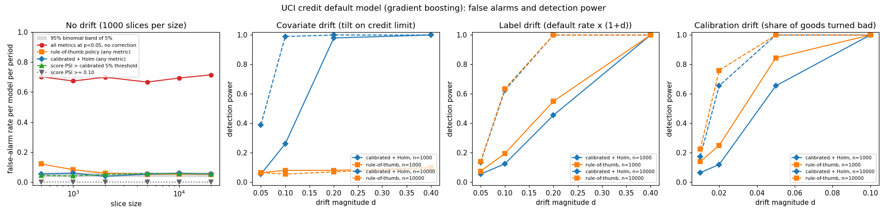

# E-23 Model Risk Monitor

Model inventory checks and drift monitoring for governance and model-risk analysts preparing for OSFI Guideline E-23: on a credit default model trained on the UCI credit-card data, its calibrated, Holm-corrected alarms held the false-alarm rate per model per period at 3.9-5.9% (nominal 5%) over 1,000 no-drift periods per slice size, where testing every metric uncorrected alarmed in 67-72% of them.



False-alarm rate per model per period, 1,000 simulated no-drift periods per slice size (95% binomial band of 5%: 3.7-6.4%). Source: [`docs/results/false_alarm.csv`](docs/results/false_alarm.csv).

| slice size | score PSI >= 0.10 | score PSI >= 0.25 | score PSI > calibrated 5% threshold | any metric, no correction | rule-of-thumb policy | calibrated + Holm |
|---|---|---|---|---|---|---|
| 500 | 0.0% | 0.0% | 4.4% | 70.2% | 12.1% | 5.4% |
| 1,000 | 0.0% | 0.0% | 4.1% | 67.4% | 8.3% | 5.9% |
| 2,000 | 0.0% | 0.0% | 5.1% | 69.9% | 6.0% | 3.9% |
| 5,000 | 0.0% | 0.0% | 5.8% | 66.7% | 5.2% | 5.3% |
| 10,000 | 0.0% | 0.0% | 5.6% | 69.4% | 5.4% | 5.9% |
| 20,000 | 0.0% | 0.0% | 5.5% | 71.5% | 5.2% | 5.4% |

## Quickstart

```bash
pip install -r requirements.txt && sudo apt-get install -y libreoffice-calc   # LibreOffice recalculates the Excel formulas
python3 -m e23mon validate examples/inventory.csv                               # inventory check: flags the planted violations
python3 -m e23mon monitor --sample --out out/                                   # breach report + Excel evidence pack
```

`out/` then holds `breach_report.md`, `breach_report.csv` (every metric, slice and model), `breach_summary.csv`, `inventory_violations.csv` and `evidence_pack.xlsx`.

To run it on your own model, export one CSV for the reference period and one per monitoring period, each with the predicted PD, the 0/1 outcome and the model inputs:

```bash
python3 -m e23mon monitor --reference dev_sample.csv --slices 2026-07.csv 2026-08.csv \
    --score-col pd --target-col default --model-id CR-PD-001 --inventory inventory.csv --out out/
```

Several models sharing the same files can be listed in a YAML config (`--config`), as in [`e23mon/sample/monitoring.yaml`](e23mon/sample/monitoring.yaml).

## Why

OSFI's final [Guideline E-23 on model risk management](https://www.osfi-bsif.gc.ca/en/news/backgrounder-guideline-e-23-model-risk-management) takes effect on May 1, 2027 and applies to all federally regulated financial institutions, including AI/ML models ([Blakes summary](https://www.blakes.com/insights/osfi-releases-final-guideline-e-23-for-model-risk-management-and-ai-use-by-frfis/)). Institutions must keep an inventory of their models, give each a risk rating that drives how often it is reviewed and monitored, and show that monitoring is ongoing.

Monitoring reports usually apply fixed rules such as "PSI above 0.25 is a breach" and look at point estimates of AUC and KS. How often such a rule fires when nothing has changed depends on the slice size, the number of bins and how many metrics are checked, so nobody knows whether a red cell means drift or noise. This project measures that and replaces the fixed rules with thresholds whose false-alarm rate is known.

## What it does

**Inventory (`e23mon/inventory.py`).** CSV or YAML with owner, use, tiering criteria (materiality, complexity, AI/ML, regulatory use), risk rating, review and monitoring dates, status, decommission date and last scoring date. Encoded rules:

| Rating | Criteria score* | Max months between reviews | Max months between monitoring runs |
|---|---|---|---|
| High | >= 8 | 12 | 1 |
| Medium | 5-7 | 24 | 3 |
| Low | <= 4 | 36 | 12 |

\*2 x materiality + complexity (High 3, Medium 2, Low 1) + 1 if AI/ML + 1 if used for regulatory or financial reporting.

The validator flags: missing owner or id, duplicate ids, invalid ratings, ratings that contradict their criteria, overdue reviews, review schedules longer than the rating allows, monitoring intervals longer than the rating allows, overdue monitoring, and decommissioned models that still produced scores after their decommission date. The example inventory has 11 models (credit, pricing, AML, AI/ML tools, finance) across all three ratings with seven planted violations; the validator finds all of them and nothing on the four clean models.

**Monitoring (`e23mon/monitor.py`, `e23mon/stats.py`).** For each model and period:

| Metric | Statistic | Null distribution |
|---|---|---|
| `psi:score` | PSI of the PD over reference deciles | resampled from the reference |
| `csi:<feature>` | CSI per input; features with <= 20 values are binned as categories, with an OTHER bin for unseen categories and a MISSING bin | resampled from the reference |
| `auc_drop`, `ks_drop` | reference AUC/KS minus slice AUC/KS, with percentile bootstrap CIs | resampled from the reference |
| `hl` | Hosmer-Lemeshow-style chi-square of slice default counts per score decile against the reference default rate of that decile | chi-square, one df per band |
| `oe` | slice observed/expected default ratio against the reference ratio | normal (Poisson-binomial variance) |

PSI/CSI use a 0.5 pseudo-count per bin, so empty bins and new categories give finite values, and bins empty in both samples are dropped.

**Calibrated thresholds.** For a slice of size *n*, the null distribution is built by drawing, 1,000 times by default, a pseudo-reference of the reference size and a pseudo-slice of size *n* from the reference, refitting the bins and recomputing every drift metric. The 95th percentile is the calibrated single-test threshold reported next to each value. P-values come from a moment-matched scaled chi-square (PSI/CSI) or normal (AUC/KS drop) fit to that distribution, so they stay smooth below 1/1,000. The calibrated threshold is the same fit's 95th percentile, which is less noisy than an empirical tail quantile. Holm's step-down correction is applied across all metrics of a model and period, which keeps the probability of any false alarm for that model in that period at or below 5%.

**Evidence pack (`e23mon/excel.py`).** `evidence_pack.xlsx` has a Summary sheet (calibrated and rule-of-thumb alarm per model and period), an Inventory sheet (validator flags, conditional formatting and a live `OVERDUE` formula against the as-of date) and one `MON_<model>` sheet per model with every metric, threshold, p-value, Holm p-value and CI, followed by the bin counts of every PSI/CSI with live formulas (`share = (count + 0.5)/(total + 0.5*bins)`, `term = (q - p)*LN(q/p)`, `PSI = SUM(terms)`) next to the Python value. The CLI recalculates the workbook in headless LibreOffice and reports the largest difference; on the sample it is 2.8e-16 over 120 tables.

## Simulation study

`scripts/run_simulation.py` (about 21 minutes on 3 cores) downloads the UCI Default of Credit Card Clients data (30,000 accounts), trains the gradient-boosting PD model on a random 30% and treats the other 21,000 scored accounts as the population. For each slice size (500 to 20,000) it builds the calibrated null from one reference of 10,000 accounts, then draws 1,000 no-drift periods, each with a fresh reference of 10,000 and a fresh slice, and 200 periods for each drift type and magnitude:

* covariate drift: resample with weights exp(-d z), z the standardized log credit limit;
* label drift: prior shift that multiplies the default rate by (1 + d), keeping the features given the outcome;
* calibration drift: a share d of non-defaulters become defaulters, so PD is understated and ranking weakens.

The rule-of-thumb policy is PSI/CSI >= 0.25, AUC or KS drop >= 0.05, O/E outside [0.8, 1.2], and HL p < 0.05, all without multiplicity correction. `python3 scripts/make_figure.py` turns `docs/results/*.csv` into the figure and the tables here.

Detection power (share of 200 drifted periods with a model-level alarm), calibrated + Holm / rule-of-thumb policy. Source: [`docs/results/power.csv`](docs/results/power.csv).

| drift | magnitude | n=500 (cal / RoT) | n=1,000 (cal / RoT) | n=2,000 (cal / RoT) | n=5,000 (cal / RoT) | n=10,000 (cal / RoT) | n=20,000 (cal / RoT) |
|---|---|---|---|---|---|---|---|
| calibration | 0.01 | 5.0% / 23.0% | 6.5% / 14.0% | 5.5% / 14.5% | 8.5% / 16.0% | 17.5% / 22.5% | 17.0% / 23.0% |
| calibration | 0.02 | 8.0% / 31.5% | 12.0% / 25.0% | 19.5% / 39.5% | 41.0% / 57.5% | 65.5% / 76.0% | 75.5% / 81.5% |
| calibration | 0.05 | 41.0% / 67.5% | 65.5% / 84.5% | 90.0% / 96.5% | 100.0% / 100.0% | 100.0% / 100.0% | 100.0% / 100.0% |
| calibration | 0.1 | 96.5% / 99.0% | 100.0% / 100.0% | 100.0% / 100.0% | 100.0% / 100.0% | 100.0% / 100.0% | 100.0% / 100.0% |
| covariate | 0.05 | 5.5% / 13.5% | 5.5% / 6.5% | 11.5% / 9.5% | 26.0% / 4.5% | 39.0% / 6.5% | 49.5% / 7.0% |
| covariate | 0.1 | 9.0% / 13.0% | 26.0% / 8.0% | 50.0% / 4.5% | 93.0% / 7.0% | 99.0% / 5.5% | 100.0% / 9.0% |
| covariate | 0.2 | 57.0% / 9.0% | 98.0% / 8.0% | 100.0% / 6.0% | 100.0% / 4.5% | 100.0% / 7.0% | 100.0% / 5.5% |
| covariate | 0.4 | 100.0% / 14.0% | 100.0% / 10.0% | 100.0% / 5.5% | 100.0% / 9.5% | 100.0% / 9.5% | 100.0% / 10.0% |
| label | 0.05 | 6.0% / 17.5% | 5.5% / 7.5% | 7.5% / 14.0% | 13.5% / 18.5% | 13.5% / 14.0% | 21.0% / 20.0% |
| label | 0.1 | 10.5% / 18.5% | 12.5% / 19.5% | 20.0% / 31.0% | 40.5% / 46.0% | 62.5% / 63.5% | 80.0% / 78.0% |
| label | 0.2 | 24.0% / 52.0% | 45.5% / 55.0% | 76.5% / 78.0% | 99.0% / 97.0% | 100.0% / 100.0% | 100.0% / 100.0% |
| label | 0.4 | 86.5% / 97.0% | 100.0% / 100.0% | 100.0% / 100.0% | 100.0% / 100.0% | 100.0% / 100.0% | 100.0% / 100.0% |

What the numbers show:

* **Fixed PSI cut-offs never fire on noise here, and that is the problem.** With deciles and a 10,000-account reference, the largest no-drift score PSI was 0.073 at n = 500 and 0.004 at n = 20,000. The 0.10/0.25 rules never alarmed without drift, and they also missed a credit-limit shift that moved the score PSI to about 0.05: the rule-of-thumb policy caught it in at most 14% of periods, while the calibrated threshold (0.0025 to 0.035 depending on slice size) caught it in 100%.
* **Testing many metrics without correction cries wolf.** With 24 PSI/CSI values, two discrimination drops and two calibration tests per period, some metric is "significant at 5%" in about 70% of no-drift periods. Holm's correction brings that back to 3.9-5.9%.
* **The rule-of-thumb policy's false-alarm rate depends on slice size**: 12.1% at n = 500, 5.2% at n = 20,000, driven by the uncorrected HL test and KS drops on small slices. Its higher power on label and calibration drift at small n comes from that higher false-alarm rate.
* **Score PSI alone, calibrated, holds its level**: 4.1-5.8% at every size, inside the binomial band.
* A first run that used the empirical 95th percentile of 1,000 null draws gave 3.6-6.8% for the single PSI test (three sizes just outside the band; [`docs/results/pilot_empirical_b1000/`](docs/results/pilot_empirical_b1000/)). The spread came from estimating a tail quantile from few draws, not from bias (the null mean matched the simulated mean within 3%), so thresholds now come from the moment-matched fit, with 4,000 draws in the study and 1,000 by default in the CLI.

## Tests

```bash
python3 -m pytest -q
```

The suite (about 30 s) checks PSI, KS, AUC, Hosmer-Lemeshow, O/E and Holm against values worked out by hand and against scikit-learn/SciPy; edge cases (empty bins, bins empty in both samples, unseen categories, missing values, a slice with a single class); every inventory rule and the planted violations in the CSV and YAML inventories; that every formula-computed PSI in the workbook matches Python to 1e-9 after a LibreOffice recalculation; the CLI end to end; and a seeded check that the calibrated 5% PSI threshold fires on 400 no-drift slices at a rate inside the binomial interval of 5%.

Tests use the bundled synthetic portfolio only; `scripts/download_data.py` fetches the UCI data for the simulation.

## Design notes

* **Null by two-sample resampling.** A monitoring slice is compared with a reference that is itself a sample, so the null resamples both: pseudo-reference and pseudo-slice. Resampling only the slice against the fixed reference understates the spread once the slice is as large as the reference.
* **Bins refit inside the null.** Decile edges come from the reference, so the null refits them on every pseudo-reference; the threshold then accounts for the edge noise too.
* **Calibration tests relative to the reference.** HL and O/E compare the slice with the reference default rates rather than with the raw PD, so a model that was slightly off at development does not alarm in every period, while a change in calibration does.
* **Smoothing is in the formula.** The pseudo-count is part of the PSI definition used everywhere, so Excel reproduces Python exactly rather than approximately.
* **Exit codes.** `validate` returns 0 and prints violations; `--strict` returns 1 when any are found, for use in a scheduled job.

## Limitations

* Thresholds assume reference and slice are independent draws; overlapping accounts or seasonal portfolios need a reference per season.
* The scaled chi-square tail is an approximation; Holm p-values for very sparse categorical features can be slightly off in the far tail.
* The calibration-drift test covers level and band shifts in default rates, not every form of miscalibration.
* The rating rule and frequencies are an example policy, not OSFI's; institutions set their own. The tool covers inventory checks and monitoring evidence, not full E-23 documentation.
* The bundled sample is synthetic; no real bank data or model names are used.

## Data

UCI Machine Learning Repository, *Default of Credit Card Clients* (Yeh, I.-C., 2009), CC BY 4.0: https://archive.ics.uci.edu/dataset/350/default+of+credit+card+clients
